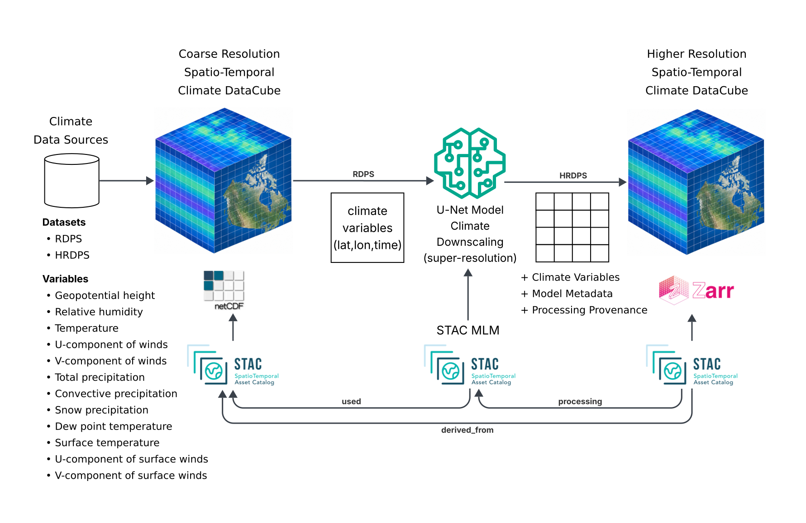
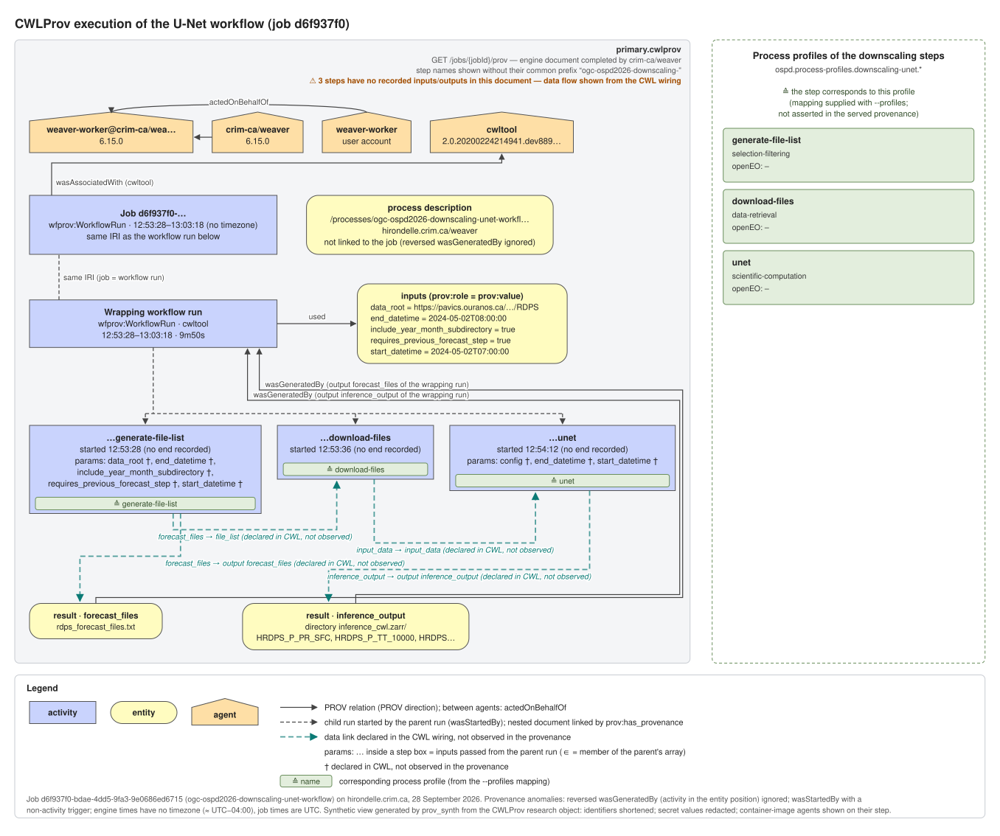

## RDPS-to-HRDPS U-Net downscaling

`ogc-ospd2026-downscaling-unet-workflow` runs the Resoterre climate downscaling pipeline:
it selects Regional Deterministic Prediction System (RDPS) forecast files for a requested time range,
downloads those files, and applies a trained U-Net to produce HRDPS-scale downscaled fields.
This workflow performs inference, not model training.

### Interacting blocks and artefacts

All **Examples** of this block describe one single use case, the RDPS-to-HRDPS U-Net inference
job `d6f937f0-bdae-4dd5-9fa3-9e0686ed6715`, each from a different angle. The graph below shows how
the example artefacts (yellow) relate to each other, to the blocks of this register (blue),
to the imported blocks that define them (grey) and to the published
or runtime resources (green). Each arrow is labelled with the relation or the fields that carry it. The legend is at the top right of the graph.

The graph is defined in
[`diagrams/bblocks-interactions.dot`](https://github.com/crim-ca/bblocks-process-profiles/blob/master/_sources/downscaling-unet/workflow/diagrams/bblocks-interactions.dot)
as a Graphviz graph. Run `python diagrams/generate_diagrams.py` to refresh the SVG files.

### Model and activity classification

The central operation is **machine-learning inference for climate-variable downscaling**.
The trained Resoterre U-Net is characterized by the **Resoterre RDPS to HRDPS U-Net MLM item**
in the [STAC Machine Learning Model block](bblocks://ogc.contrib.stac.extensions.mlm).
That example describes the model's inputs and outputs, tensor structures, training metadata,
runtime requirements and associated STAC extensions. The
[published model Item](https://hirondelle.crim.ca/stac/collections/stac-mlm-examples/items/ogc-ospd2026-downscaling-unet)
connects the executable process to that model characterization.
The [STAC Browser view](https://hirondelle.crim.ca/stac-browser/collections/stac-mlm-examples/items/ogc-ospd2026-downscaling-unet)
provides an interactive presentation of the same Item. Machine-readable model references use the STAC API URL.

The workflow is both an **ML activity** and a **geoprocessing activity**:
it applies a trained model to new inputs, making it an inference activity, and transforms
georeferenced RDPS climate fields into finer-resolution HRDPS-scale fields, making it spatial
data processing. These are complementary classifications of the same operation, not alternative
labels. The workflow references the
[ML activity types profile](bblocks://ogc.model.registered-item.ml-activity-types) and
[geoprocessing activity types profile](bblocks://ogc.model.registered-item.geoprocessing-activity-types);
its process-type example records the climate-downscaling and climate-downscaling-inference
activity types. File selection and download prepare the model inputs rather than train the model.

The **Activity types, model bindings and inference enrichment** example supplies the actual
candidate type definitions, spatial/ML entity contracts, procedure links and submitted registration
metadata. Its selectable Turtle snippets reuse the imported classes and select the model's two input
specifications and one output specification in the published Item without duplicating their tensors.
The captured U-Net step is enriched separately from the original CWLProv records and references
the versioned Resoterre runtime environment, including its framework and model dependencies.

No governed register action has been established for this execution. Because the upstream ML
execution class also requires such an action, the enrichment uses a PROV execution with a `dct:type`
classification, not a claim of full upstream ML execution-profile conformance. Logical model-ready
inputs and predictions are explicitly marked as reconstructed, not individually captured tensors.

The **Published STAC MLM model Item (external source)** example includes the actual Item fetched
at build time. It shows the named inputs/outputs, tensor structures, geometry, bounding box and
temporal properties beside the RDF bindings. Structure bindings select the existing tensor contracts.
The extent bindings additionally materialize a GeoSPARQL WKT geometry in longitude/latitude CRS84
and OWL-Time timestamp literals from the selected source values. These are source-derived RDF views
provided for readability, but original material remains referenced through explicit `oa:hasSource` links.
The semantic validation script checks their equality with the live Item and fails on drift.
The model-specific inference type declares both domains through `dct:spatial` and `dct:temporal`.
The generic climate-downscaling type does not acquire this particular model's limits since they are
distinctively applicable to various climate model implementations and training constraints.
Each spatial input/output class links to its corresponding model specification, and reconstructed
entities link to both model domains through `pp:modelSpatialDomain` and `pp:modelTemporalDomain`.
These domains are not validity interval for the input or output data entities, only the recommended
and applicable domains that the model itself was designed for. The inferred forecast valid-time
interval is recorded separately from execution timestamps and the model's declared temporal domain.

The enrichment's PROV association references the exact packed CWL plan in the captured provenance,
linked to its pinned source CWL. Explicit reified statements display every ML predicate mapping,
including framework, performed tasks, inputs/outputs and structure. They describe, but do not assert,
the upstream domain-entailing predicates while the register-action modelling conflict is unresolved.
`rim:validityStatus` is the normal imported RIM predicate, distinct from publication status.
Local type definitions use `dcat:version "0.1"`; RIM has no `rim:version` property. This definition
version is distinct from the deployed model/software version `0.1.3-dev.10`.

The standard postprocessor checks the rendered examples.
The `validation/` directory holds the negative fixtures and a script that needs pySHACL >= 0.30,
which is newer than the postprocessor image. Run `python validation/validate_semantics.py` for the complete
merged-graph check. It also checks live model selectors, exact source-derived geometry and temporal endpoints,
and rejects missing spatial/output type declarations, extent literals and applicability links.
It requires pySHACL 0.30 or later: the postprocessor's older 0.21 validator does not enforce those
upstream nested activity-type constraints reliably.

### Processing steps

The sequence follows the descriptions and input/output contracts of the three component processes:

1. [Generate file list](bblocks://ospd.process-profiles.downscaling-unet.generate-file-list)
   (`ogc-ospd2026-downscaling-generate-file-list`) selects the RDPS forecast files needed to cover
   `start_datetime` through `end_datetime`. It prepends `data_root` to each file reference and writes
   the `forecast_files` text file. `requires_previous_forecast_step` includes the preceding forecast
   step needed for cumulative variables such as precipitation. `include_year_month_subdirectory`
   controls whether the paths include year/month directories or use a flat layout.
2. [Download files](bblocks://ospd.process-profiles.downscaling-unet.download-files)
   (`ogc-ospd2026-downscaling-download-files`) reads the file list and downloads its entries into
   the working directory exposed as `input_data`. Its process description supports HTTP(S) URLs
   and local paths accessible from the execution container.
3. [U-Net inference](bblocks://ospd.process-profiles.downscaling-unet.unet)
   (`ogc-ospd2026-downscaling-unet`) reads the input NetCDF directory and runs RDPS-to-HRDPS
   downscaling over the requested time range. The inference image includes the trained model,
   regridding matrices, geophysical fields, and default configuration. An optional `config` YAML
   file overrides that configuration; the workflow also passes the requested start/end datetimes.

### Inputs and results

The required inputs are `start_datetime` and `end_datetime`. Optional inputs control forecast-step
selection, source path layout, the data root, and the inference configuration.
The workflow returns `forecast_files`, the selected source-file list, and `inference_output`,
a Zarr directory containing the inference results. The downloaded NetCDF directory is an intermediate
passed between the download and inference steps, not a separate workflow output.

### Execution examples and provenance

The **Examples** tab includes the CWL workflow application package, its OGC API process description,
the Application Package deployment reference and the process-type register entry linking the
workflow to its model and activity classifications. The **execution request** example provides
the JSON `inputs` body for the illustrated 2024-05-02 time range, the process execution endpoint,
and headers for asynchronous submission. The optional configuration is omitted to use the
inference image's default configuration.

The **CWLProv execution provenance** example records job
`d6f937f0-bdae-4dd5-9fa3-9e0686ed6715`, captured on 2026-09-28. It describes the workflow
and individual step runs, their plans, input/output entities, associated agents and PROV
relationships. Turtle, expanded JSON-LD, N-Triples, PROV-JSON, PROV-N and PROV-XML representations
are provided with links to their definitions in
[the PROV representation register](https://ogcincubator.github.io/bblocks-prov-jsonld-alt/).
The captured packed CWL and job-input document are also linked from that example, so the execution
metadata can be inspected alongside the workflow and submitted input values. The supplied metadata
are not a complete BagIt archive of the execution's data payloads.

The diagram below is a synthetic view of this CWLProv capture, generated by `scripts/prov_synth.py`.
It shows the job and wrapping workflow runs, the agents, the three step runs matched to their
process profiles, the submitted inputs and the two results. Data links between steps are declared
in the CWL wiring and not observed in the captured records, and are drawn as such.

The provenance content aligns with the process, job, input/output and agent relationships described
in [draft OGC API - Processes - Part 5: Provenance](https://docs.ogc.org/DRAFTS/26-038.html).
Metadata alignment does not by itself establish server conformance to that draft.
